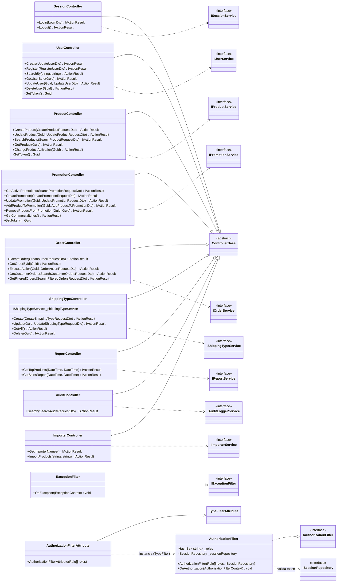

# Diagrama de clases — Capa WebApi

Controllers (REST), filtros de autorización y manejo de excepciones.
Cada controller depende de una **interfaz de servicio** (capa `IBussinesLogic`) — no de implementaciones concretas.



> **Notas**
> - Todos los controllers se decoran con `[AuthorizationFilter([roles...])]` para proteger sus endpoints por rol; `[]` = solo requiere sesión válida.
> - `ExceptionFilter` se registra **globalmente** en `Program.cs` (`options.Filters.Add<ExceptionFilter>()`) y mapea excepciones de dominio a códigos HTTP (`ConflictException`→409, `ArgumentException`→400, `InvalidOperationException`→422, `KeyNotFoundException`→404, `UnauthorizedAccessException`→401).
> - `Program.cs` es la *composition root*: configura CORS, registra los servicios (vía `ServiceFactory`) y los filtros.
```
