# Diagrama de clases — Capa DTOs

Objetos de transferencia (request/response) agrupados por área funcional.
Las flechas muestran composición entre DTOs y dependencia con enums del dominio (`Domain.Enums`).

```mermaid
classDiagram
    direction LR

    %% ===== Enums del dominio (referenciados) =====
    class OrderStatus
    class OrderAction
    class Role
    <<enumeration>> OrderStatus
    <<enumeration>> OrderAction
    <<enumeration>> Role

    namespace UserDTOs {
        class LoginDto {
            +string Email
            +string Password
        }
        class LoginResponseDto {
            +Guid Token
            +UserSummaryDto User
        }
        class RegisterUserDto {
            +string Name
            +string Surname
            +string Email
            +string Phone
            +string Password
        }
        class UpdateUserDto {
            +Guid Id
            +string Name
            +string Surname
            +string Email
            +string Phone
            +string Password
            +Role Role
            +bool IsInternal
            +bool IsActive
        }
        class UserSummaryDto {
            +Guid Id
            +string Name
            +string Surname
            +string Email
            +Role Role
        }
    }

    namespace OrderDTOs {
        class CreateOrderRequestDto {
            +Guid CustomerId
            +Guid ShippingTypeId
            +string Street
            +string DoorNumber
            +string Apartment
            +List~CreateOrderLineRequestDto~ Lines
        }
        class CreateOrderLineRequestDto {
            +Guid ProductId
            +int Quantity
        }
        class CreateOrderResponseDto {
            +Guid OrderNumber
            +Guid CustomerId
            +DateTime CreatedAt
            +OrderStatus Status
            +decimal Subtotal
            +decimal ShippingCost
            +decimal Total
        }
        class OrderActionRequestDto {
            +OrderAction Action
        }
        class OrderStatusChangeResponseDto {
            +Guid OrderNumber
            +OrderStatus Status
            +DateTime ChangedAt
        }
        class OrderSummaryDto {
            +Guid OrderNumber
            +Guid CustomerId
            +string CustomerEmail
            +DateTime CreatedAt
            +OrderStatus Status
            +decimal Total
            +int TotalProducts
        }
        class OrderDetailResponseDto {
            +Guid OrderNumber
            +Guid CustomerId
            +string CustomerEmail
            +string CustomerName
            +DateTime CreatedAt
            +OrderStatus Status
            +string ShippingType
            +decimal ShippingCost
            +string Street
            +string DoorNumber
            +string Apartment
            +decimal Subtotal
            +decimal Total
            +List~OrderLineResponseDto~ Lines
        }
        class OrderLineResponseDto {
            +Guid ProductId
            +string ProductName
            +int Quantity
            +decimal UnitPrice
            +decimal Discount
            +decimal Subtotal
        }
        class SearchCustomerOrdersRequestDto {
            +Guid CustomerId
            +DateTime? From
            +DateTime? To
            +string? Status
            +int Page
            +int PageSize
        }
        class SearchFilteredOrdersRequestDto {
            +DateTime From
            +DateTime To
            +string? Status
            +string? AddressText
            +int Page
            +int PageSize
        }
    }

    namespace ProductsDTOs {
        class CreateProductRequestDto {
            +string Code
            +string Name
            +decimal Price
            +string Description
            +string CommercialLineName
            +string CategoryName
            +List~IFormFile~ Images
        }
        class UpdateProductRequestDto {
            +string Name
            +string Description
            +decimal Price
            +string CommercialLineName
            +string CategoryName
            +List~IFormFile~ Images
        }
        class ProductSummaryDto {
            +Guid Id
            +string Code
            +string Name
            +string Description
            +decimal Price
            +string CommercialLineName
            +string CategoryName
            +List~string~ ImageUrls
            +bool IsActive
        }
        class SearchProductRequestDto {
            +string? Name
            +Guid? CommercialLineId
            +Guid? CategoryId
            +int Page
            +int PageSize
        }
    }

    namespace PromotionsDTOs {
        class CreatePromotionRequestDto {
            +string Name
            +DateTime StartDate
            +DateTime EndDate
            +int Discount
            +Guid CommercialLineId
            +List~Guid~ ProductIds
        }
        class UpdatePromotionRequestDto {
            +string Name
            +DateTime StartDate
            +DateTime EndDate
            +int Discount
        }
        class PromotionSummaryDto {
            +Guid Id
            +string Name
            +DateTime StartDate
            +DateTime EndDate
            +int Discount
            +string CommercialLineName
            +List~string~ ProductNames
        }
        class AddProductToPromotionDto {
            +Guid ProductId
        }
        class SearchPromotionRequestDto {
            +DateTime? Date
            +Guid? CommercialLineId
            +Guid? ProductId
            +int Page
            +int PageSize
        }
    }

    namespace ReportDTOs {
        class TopProductDto {
            +string Code
            +string Name
            +int Quantity
            +List~string~ Images
        }
        class MonthlySalesDto {
            +string Period
            +List~CustomerSalesDto~ Customers
            +decimal Total
        }
        class CustomerSalesDto {
            +string CustomerName
            +decimal Total
        }
    }

    namespace ShippingTypeDTOs {
        class CreateShippingTypeRequestDto {
            +string Name
            +decimal Cost
        }
        class UpdateShippingTypeRequestDto {
            +string Name
            +decimal Cost
        }
        class ShippingTypeResponseDto {
            +Guid Id
            +string Name
            +decimal Cost
            +bool IsDefault
        }
    }

    namespace AuditDTOs {
        class CreateLogDto {
            +string Username
            +string Action
            +string EntityName
            +Guid EntityId
            +string EntityDisplayName
        }
        class SearchAuditRequestDto {
            +DateTime From
            +DateTime To
            +string EntityName
            +Guid EntityId
        }
        class AuditLogResponseDto {
            +Guid Id
            +DateTime Time
            +string? EntityName
            +Guid? EntityId
            +string? Description
            +string Username
        }
    }

    namespace CommercialLineDTOs {
        class CommercialLineDto {
            +Guid Id
            +string Name
        }
    }

    %% ===== Relaciones entre DTOs =====
    LoginResponseDto --> UserSummaryDto : User
    CreateOrderRequestDto "1" *-- "*" CreateOrderLineRequestDto : Lines
    OrderDetailResponseDto "1" *-- "*" OrderLineResponseDto : Lines
    MonthlySalesDto "1" *-- "*" CustomerSalesDto : Customers

    %% ===== Dependencias con enums =====
    UpdateUserDto ..> Role
    UserSummaryDto ..> Role
    OrderActionRequestDto ..> OrderAction
    CreateOrderResponseDto ..> OrderStatus
    OrderStatusChangeResponseDto ..> OrderStatus
    OrderSummaryDto ..> OrderStatus
    OrderDetailResponseDto ..> OrderStatus
```



> **Notas**
> - Los DTOs son *data carriers* (solo propiedades, sin lógica). Se mapean a/desde entidades de `Domain` en la capa `BusinessLogic` (mappers).
> - `CreateProductRequestDto` y `UpdateProductRequestDto` reciben `List<IFormFile>` (subida de imágenes vía `multipart/form-data`).
> - Los enums `OrderStatus`, `OrderAction` y `Role` viven en `Domain.Enums`; acá solo se referencian.
```
