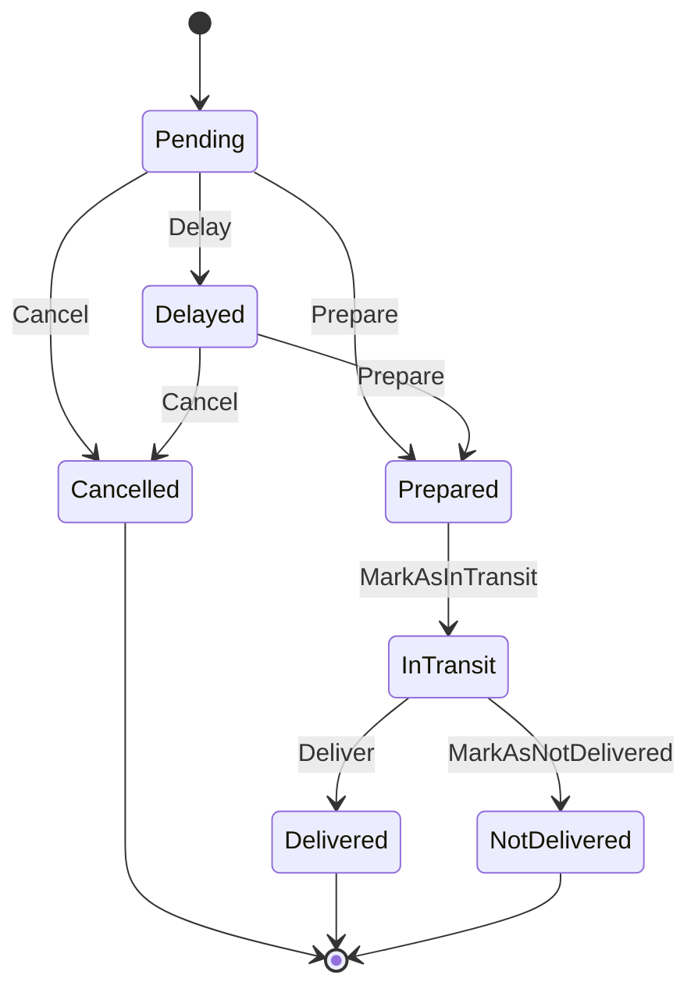

# DarkKitchen

Sistema de gestión para una *dark kitchen* (cocina que solo trabaja con delivery): catálogo de productos, promociones, pedidos con seguimiento de estado, tipos de envío, usuarios con roles, reportes, auditoría e importación de productos mediante plugins.

> **Nota sobre la autoría**
>
> Este proyecto fue desarrollado en equipo junto a **dos compañeros más** como obligatorio del curso *Diseño de Aplicaciones 2*. Este repositorio es una copia del original, clonada para mi portfolio personal. Por privacidad, **se omitieron los nombres y datos de mis compañeros** y no se incluyó el historial de commits original. Todo el mérito del trabajo es compartido entre los tres integrantes.

---

## Tabla de contenidos

- [Tecnologías](#tecnologías)
- [Estructura del repositorio](#estructura-del-repositorio)
- [Arquitectura del backend](#arquitectura-del-backend)
- [Funcionalidades](#funcionalidades)
- [Roles y permisos](#roles-y-permisos)
- [Ciclo de vida de un pedido](#ciclo-de-vida-de-un-pedido)
- [Importadores (plugins por Reflection)](#importadores-plugins-por-reflection)
- [API REST](#api-rest)
- [Cómo levantar el proyecto](#cómo-levantar-el-proyecto)
- [Desarrollo local sin Docker](#desarrollo-local-sin-docker)
- [Tests](#tests)
- [Documentación adicional](#documentación-adicional)

---

## Tecnologías

| Capa | Tecnología |
|---|---|
| Backend | .NET 8, ASP.NET Core Web API, Entity Framework Core 8 |
| Base de datos | SQL Server 2022 |
| Frontend | Angular 19, Angular Material |
| Tests | MSTest, Moq (backend) · Jasmine, Karma (frontend) |
| Despliegue | Docker (API, frontend servido con nginx, SQL Server) |

---

## Estructura del repositorio

```text
.
├── Backend/                 Solución .NET (DarkKitchen.sln)
│   ├── Domain/              Entidades, enums y reglas de negocio (incluye el patrón State de pedidos)
│   ├── DTOs/                Objetos de entrada/salida de la API
│   ├── IBussinesLogic/      Interfaces de los servicios de negocio
│   ├── BusinessLogic/       Servicios, mappers y carga de plugins por Reflection
│   ├── IRepository/         Interfaces de acceso a datos
│   ├── Repository/          Implementación con EF Core + migraciones
│   ├── IImporters/          Contrato público para crear importadores (plugins)
│   ├── ServiceFactory/      Registro de dependencias (inyección de dependencias)
│   ├── WebApi/              Controllers, filtros de autorización y de excepciones
│   ├── *Tests/              Tests unitarios de cada capa
│   └── docs/                Diagramas UML (PlantUML) y material de defensa
├── Frontend/                Aplicación Angular
├── JsonImporter/            Plugin que importa productos desde JSON
├── XmlImporter/             Plugin que importa productos desde XML
├── Datos/                   Scripts SQL y guía de despliegue
└── Aplicacion/              Build ya compilado de la API y del frontend
```

---

## Arquitectura del backend

El backend está organizado en capas, y cada capa depende solo de **abstracciones** (proyectos `I*`), nunca de implementaciones concretas:

```text
WebApi ──► IBussinesLogic ◄── BusinessLogic ──► IRepository ◄── Repository ──► SQL Server
   │                               │                                  │
   └──────────── DTOs ─────────────┘                                  │
                                   └──────────► Domain ◄──────────────┘

ServiceFactory: conecta interfaces con implementaciones (único lugar que conoce a todas)
IImporters:     contrato que implementan los plugins externos (JsonImporter, XmlImporter)
```

Decisiones de diseño destacadas:

- **Inversión de dependencias (DIP):** la WebApi y la lógica de negocio trabajan contra interfaces. `ServiceFactory` es el único proyecto que registra las implementaciones concretas.
- **Patrón State:** cada estado de un pedido (`PendingOrderState`, `PreparedOrderState`, etc.) es una clase que decide qué transiciones están permitidas.
- **Plugins por Reflection:** se pueden agregar nuevos formatos de importación sin recompilar el sistema (principio Open/Closed).
- **Filtros transversales:** `AuthorizationFilter` valida el token y el rol en cada endpoint, y `ExceptionFilter` convierte las excepciones de dominio en respuestas HTTP.
- **Auditoría:** las acciones relevantes quedan registradas y se pueden consultar.

---

## Funcionalidades

- **Autenticación:** login y logout con token de sesión; registro de clientes.
- **Usuarios:** alta, edición, baja y búsqueda (administración interna).
- **Productos:** alta y edición con imágenes, listado con filtros, activación y desactivación.
- **Promociones:** creación y edición, asociación de productos, consulta por línea comercial.
- **Tipos de envío:** ABM de las modalidades de envío.
- **Pedidos:** el cliente crea pedidos y ve su historial; el despachador y el administrador los filtran y cambian su estado.
- **Reportes:** productos más vendidos y ventas.
- **Auditoría:** búsqueda en el registro de acciones del sistema.
- **Importación:** carga masiva de productos desde archivos JSON o XML mediante plugins.

---

## Roles y permisos

| Rol | Puede |
|---|---|
| **Client** | Registrarse, ver productos y promociones, crear pedidos y ver los suyos |
| **Dispatcher** | Ver y filtrar pedidos, cambiar su estado |
| **Admin** | Todo lo anterior, más gestionar usuarios, productos, promociones, tipos de envío, reportes, auditoría e importadores |

Los permisos se aplican en el backend con el atributo `[AuthorizationFilter([...roles])]` y en el frontend con guards de ruta (`auth.guard`, `role.guard`).

---

## Ciclo de vida de un pedido



Una transición que no está permitida desde el estado actual lanza una excepción de dominio, y la API la devuelve como error.

---

## Importadores (plugins por Reflection)

El proyecto `IImporters` define el contrato `IProductImporter`, que tiene un `Name` y un método `GetProducts(path)` que devuelve una lista de `ImportedProduct`.

1. Al compilar la `WebApi`, los DLL de `JsonImporter`, `XmlImporter` e `IImporters` se copian a la carpeta `Plugins/`.
2. En tiempo de ejecución, `AssemblyLoader` recorre esa carpeta, carga cada DLL y crea una instancia de cada clase que implemente `IProductImporter`.
3. `ImporterService` valida cada producto: el código no puede estar repetido y las imágenes deben ser `.jpg` de hasta 500 KB. Si la línea comercial o la categoría no existen, las crea. Después copia las imágenes a `wwwroot/images/products` y guarda los productos.

**Para agregar un formato nuevo:** creá un proyecto que referencie solo `IImporters`, implementá `IProductImporter`, compilalo y copiá el DLL a `Plugins/`. No hace falta tocar el código del sistema.

En [`test-import.txt`](test-import.txt) hay un ejemplo del formato JSON (las rutas de las imágenes son absolutas y hay que adaptarlas a tu máquina).

---

## API REST

Todas las rutas empiezan con `/api`. Los endpoints protegidos esperan el header `Authorization: <token>`, donde `<token>` es el que devuelve el login.

| Recurso | Endpoints |
|---|---|
| Sesión | `POST /session/login` · `DELETE /session` |
| Usuarios | `POST /users` · `POST /users/registrations` · `GET /users` · `GET/PUT/DELETE /users/{id}` |
| Productos | `POST /products` · `GET /products` · `GET/PUT/PATCH /products/{id}` |
| Promociones | `GET/POST /promotions` · `PUT /promotions/{id}` · `POST/DELETE /promotions/{id}/products` · `GET /promotions/commercial-lines` |
| Tipos de envío | `GET/POST /shipping-types` · `PUT/DELETE /shipping-types/{id}` |
| Pedidos | `POST /orders` · `GET/PATCH /orders/{id}` · `GET /orders/customer` · `GET /orders/customerF` |
| Reportes | `GET /reports/top-products` · `GET /reports/sales` |
| Auditoría | `GET /audit` |
| Importadores | `GET /importers` · `POST /importers/import` |

En `Backend/WebApi/DarkKitchenApi.http` hay ejemplos de requests.

---

## Cómo levantar el proyecto

**Requisitos:** Docker. No hace falta instalar .NET ni Node, porque las imágenes compilan todo.

Los comandos son para bash (Linux, macOS o WSL). En PowerShell, cambiá `\` por `` ` `` al final de cada línea.

```bash
# 1. Red y SQL Server
docker network create da2-network
docker run --network da2-network -d --name sql -p 1433:1433 \
  -e ACCEPT_EULA=Y -e MSSQL_SA_PASSWORD=La_Contrasenia123 -e MSSQL_PID=Developer \
  mcr.microsoft.com/mssql/server:2022-latest
# Esperar unos 30 segundos a que SQL Server termine de iniciar

# 2. Base de datos: esquema y datos de prueba
SQLCMD="docker exec sql /opt/mssql-tools18/bin/sqlcmd -S localhost -U SA -P La_Contrasenia123 -C"
$SQLCMD -Q "CREATE DATABASE DarkKitchen"
docker cp Datos/database-empty.sql sql:/tmp/database-empty.sql
docker cp Datos/database-with-test-data.sql sql:/tmp/database-with-test-data.sql
$SQLCMD -d DarkKitchen -i /tmp/database-empty.sql
$SQLCMD -i /tmp/database-with-test-data.sql

# 3. API
docker build -f Backend/WebApi/Dockerfile -t deploy/api:latest .
docker run --network da2-network -d --name api -p 5222:5222 \
  -e "ConnectionStrings__DefaultConnection=Server=sql,1433;Database=DarkKitchen;User Id=SA;Password=La_Contrasenia123;TrustServerCertificate=True;Encrypt=False" \
  deploy/api:latest

# 4. Frontend
docker build -t deploy/frontend:latest Frontend
docker run --network da2-network -d --name frontend -p 8080:80 deploy/frontend:latest
```

Abrí **http://localhost:8080** y entrá con el usuario administrador de prueba:

```text
Email:      admin@darkkitchen.com
Contraseña: AdminPass2026!X
```

| Servicio | URL |
|---|---|
| Frontend | http://localhost:8080 |
| API | http://localhost:5222 |
| SQL Server | localhost:1433 (usuario `SA`) |

Para bajar todo:

```bash
docker rm -f frontend api sql && docker network rm da2-network
```

En [`Datos/guia_deploy.md`](Datos/guia_deploy.md) está la guía paso a paso en PowerShell, con la alternativa de aplicar las migraciones con `dotnet ef`.

---

## Desarrollo local sin Docker

**Requisitos:** .NET 8 SDK, Node 20 o superior, y un SQL Server accesible (puede ser el contenedor `sql` de arriba).

1. Configurá la connection string en `Backend/WebApi/appsettings.Development.json`:

   ```json
   {
     "ConnectionStrings": {
       "DefaultConnection": "Server=localhost,1433;Database=DarkKitchen;User Id=SA;Password=La_Contrasenia123;TrustServerCertificate=True;Encrypt=False"
     }
   }
   ```

2. Creá la base, ya sea con los scripts SQL de la sección anterior o con las migraciones:

   ```bash
   dotnet tool install --global dotnet-ef --version 8.*
   dotnet ef database update -p Backend/Repository/Repository.csproj -s Backend/WebApi/WebApi.csproj
   ```

3. Levantá la API, que queda en `http://localhost:5128`, el puerto que usa el entorno de desarrollo del frontend:

   ```bash
   dotnet run --project Backend/WebApi
   ```

4. Levantá el frontend, que queda en `http://localhost:4200`:

   ```bash
   cd Frontend
   npm install
   npm start
   ```

---

## Tests

```bash
dotnet test Backend/DarkKitchen.sln        # Domain, Repository, BusinessLogic, WebApi
dotnet test JsonImporter/JsonImporter.sln
dotnet test XmlImporter/XmlImporter.sln
```

El backend tiene unos 470 tests unitarios (MSTest + Moq). Los servicios se prueban con mocks de los repositorios y del `IAssemblyLoader`, así que no necesitan base de datos ni DLLs reales.

---

## Documentación adicional

En `Backend/docs/diagramas/` están los diagramas en PlantUML:

- `01-webapi` y `02-dtos`: diagramas de paquetes y clases.
- `03-implementacion`: diagrama de implementación.
- `04-despliegue`: diagrama de despliegue.
- `05-mer`: modelo entidad-relación.
- `06-herencia-orderstate`: jerarquía del patrón State de pedidos.
